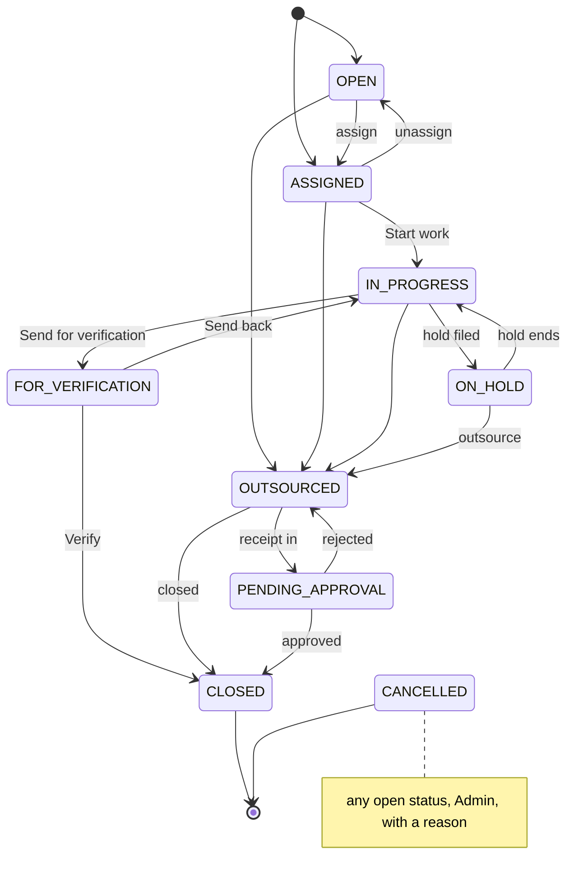

# 0014. Ticket status lifecycle: one transition table in code, verify and send back

**Date**: 2026-10-31
**Status**: Accepted

## Summary

VRMS gets one official list of status moves (a transition table): from which status a ticket may go to which, who may make each move, and what each move needs. It lives in one backend file, every status change goes through it, and the web app shows only the moves the server sends. This feature also turns on verification for the Chief Mechanic through a new `ticket.verify` right, adds Send back (Reject) as the first backward move, and makes the stale check (optimistic lock) required and safe. Holds, outsourcing, approval and assignment moves are written into the table now, but each is switched on by its own later feature.

Decision history (context, options, rationale): [rationale.md](rationale.md).

## Requirements

**User stories**:
- As the team, we want one list of ticket statuses and allowed moves, so that every feature uses the same rules (WL-200).
- As a Chief Mechanic, I want to verify or send back finished work and have my name recorded, so that accountability is clear (WL-212).
- As a Mechanic, I want to see why my work came back and resend it without rewriting my notes, so that a small fix stays a small fix.
- As an Admin, I want the server to reject any move outside the list with a clear message, so that no ticket ends up in a state nobody can explain.

**Acceptance criteria**:

*The table*
- **AC-1**: `src/modules/vrms/ticket-transitions.ts` in backend-vrms is the one definition of status moves. It holds exactly the 14 moves in *Transition table* below, each with `from`, `to`, `trigger`, `right` (for status endpoint moves) and `needs`. A ticket is created only as `OPEN` or `ASSIGNED`. Every status write after create goes through one helper, `applyStatusMove`, which refuses any move not in the table. This includes the existing release on unassign in `mechanic-work.service.ts` (today a direct `ASSIGNED` to `OPEN` write): it calls `applyStatusMove` with trigger `assignment` and a system actor, and keeps its one `MECHANIC_UNASSIGNED` audit row, which already records the status change (no second `STATUS_CHANGE` row). `FORWARD_MOVES` and `MECHANIC_ALLOWED_TRANSITIONS` in `repairs.service.ts` and the `FORWARD` map in web `nextAction.ts` are gone.
- **AC-2**: Every open status has at least one move out, counting moves of every trigger (so `OPEN`, `ON_HOLD`, `OUTSOURCED` and `PENDING_APPROVAL` pass through their owner moves and Cancel); `CLOSED` and `CANCELLED` have none. A unit test proves both from the table. The lifecycle diagram in this spec matches the table.
- **AC-3**: `PATCH /vrms/repairs/:id/status` accepts only moves whose trigger is `status` (M3 to M6, M14). Any other target answers 400 `{ statusCode: 400, code: 'INVALID_TRANSITION', message, allowed }`. The message names both statuses by label ("Can't move a ticket from 'Closed' to 'In progress'."); for a move owned by a later feature it names that action instead ("A ticket goes On hold when a hold is filed, not from here."). `allowed` lists the status endpoint targets from the current status that this caller may make (the same list as `moves`, AC-13).
- **AC-3a**: The status endpoint checks in this order, and the first failure answers: 404 ticket not found · 400 body validation · 409 stale (`lastUpdatedAt` differs) · 400 `INVALID_TRANSITION` (which also covers today's finished lock) · 403 right or self verification · 400 a missing `needs` value (remarks, cancel reason, resolutions). Stale comes before the move check, so the loser of a race on a ticket that has just closed gets 409, not 400.
- **AC-4**: No move leaves `CLOSED` or `CANCELLED` through the status endpoint, even when the ticket is unlocked. Unlock stays a cost correction only; reopening is feature 33's override. A body with the same status as the ticket is a 400 `INVALID_TRANSITION` on an open ticket; on an unlocked finished ticket it keeps today's behaviour (save, then lock again), through the same stale check.

*Rights*
- **AC-5**: The permission catalog gains `ticket.verify` ("Verify or send back finished work", group Tickets): Admin on, Chief Mechanic on, Mechanic off, not locked. On the next startup the backfill (spec 0011, AC-3) inserts its 3 rows (20 keys, 60 rows in all). A test checks that `/vrms/permissions/me` for each role equals the catalog defaults with modules on (no hard coded counts). `ticket.administer` is relabelled "Cancel tickets and make work moves on any ticket". The status route's guard becomes `@RequirePermission('ticket.work', 'ticket.administer', 'ticket.verify')`, and spec 0011's route table says so; the per move rights stay in the service.
- **AC-6**: Start work and Send for verification need `ticket.work` on a ticket assigned to the caller, or `ticket.administer` on any ticket. Verify and Send back need `ticket.verify` and `read` on the ticket (so a role with `verify` but no view key can't act on unseen tickets), and are refused when the caller is assigned to that ticket: 403 "Someone else must verify work on a ticket you're assigned to." Cancel needs `ticket.administer`. A caller without the move's right gets 403 "You can't make this move on this ticket." (replacing today's "Mechanics cannot change status to ..." message). `ticket.administer` alone no longer closes a ticket. A Chief Mechanic may verify a ticket with no costs entered; an Admin adds them later through Unlock.

*The moves*
- **AC-7**: Verify (M5) sets `CLOSED`, `closedAt`, and `verifiedByUserId`, `verifiedByName`, `verifiedAt` to the caller (Admin or Chief Mechanic). The vehicle goes back to `AVAILABLE` and the odometer sync runs inside the same transaction as the status write.
- **AC-8**: Send back (M6) needs `remarks` of 5 to 500 characters after trimming (400 "Say what needs fixing." otherwise). The ticket goes to `IN_PROGRESS` and the `STATUS_CHANGE` audit row carries the remarks as its note. Send back does not write `ticket.remarks` ("Latest remark"); the comment shows through `lastRejection` only, so it can't linger after the resend. The vehicle stays `UNDER_REPAIR`; only M5, M11, M12 and M14 release it.
- **AC-9**: Every move into `IN_PROGRESS` keeps each issue's ticked steps, `resolutionNote`, `hoursSpent` and `followedKnownFix`, and clears `resolvedAt` on every issue of the ticket, in the same transaction as the status write.
- **AC-10**: Cancel (M14) works from any of the seven open statuses with a required reason, sets `closedAt`, records no verifier, and frees the vehicle inside the same transaction.
- **AC-11**: Send for verification (M4) keeps spec 0007 AC-31 exactly: resolutions required for every issue while the knowledge module is on.

*Concurrency*
- **AC-12**: `lastUpdatedAt` is required (`@IsISO8601`, so a malformed value is 400, not 409) on the status body, the unlock body (`UnlockTicketDto`) and the costs body (`PATCH :id/costs`). Each of the three checks it before the write and again inside an interactive transaction with a conditional `updateMany({ where: { id, updatedAt }, data: { updatedAt: now, ... } })` (the pattern `linkKnowledge` uses); a count of 0 answers 409 with the existing stale message. Inside a move, the order is: conditional ticket update · issue updates (resolutions or the backward rule, as explicit `tx.repairIssue.update` calls) · audit insert · vehicle release and odometer sync, with the odometer read inside the transaction. All of it lands together or not at all. There is no grace period for callers that don't send the field: web and backend deploy together.

*Reads*
- **AC-13**: Every single ticket response (detail, status, unlock, costs, link, built in `present()`) carries `moves: { to, label, kind, needs }[]`: the status endpoint moves from the current status that this caller may make right now (rights, `read` and self verification applied, from the ticket's loaded assignments). `needs` for Send for verification is `resolutions` only while the knowledge module is on, else `null`. A finished ticket has `moves: []`; Unlock stays on `can.unlock`. `can` gains `verify`. List responses (`formatTicket`) carry neither `moves` nor `lastRejection`.
- **AC-14**: Single ticket responses carry `lastRejection: { remarks, byName, at } | null`. Source: the ticket's newest `STATUS_CHANGE` audit rows, ordered `createdAt desc, id desc`, read through `readChanges` and scanned in code. Scanning newest first, the first row whose `repairStatus` change goes into `FOR_VERIFICATION` ends the scan with `null`; the first row going `FOR_VERIFICATION` to `IN_PROGRESS` gives `remarks` (its `note`), `byName` (`actorName`, else `actorEmail`) and `at` (its `createdAt`, ISO). Shown only while the ticket is `IN_PROGRESS` or `ON_HOLD`; otherwise `null`.

*Web*
- **AC-15**: `nextAction.ts` builds the detail page's actions from `ticket.moves` only and returns a list: the primary action (the forward move, or Unlock), an optional secondary action (Send back), and Cancel. The desktop bar shows primary and secondary side by side; the phone `NextActionBar` shows the primary button full width with Send back as a second button beneath it; Cancel stays a link as today. The "No mechanic is assigned yet" and missing costs callouts key off the primary move's `to`. At For verification with no move, the page reads "Waiting for verification."
- **AC-16**: Send back opens the shared note dialog with a required "What needs fixing?" field (5 to 500 characters); submit stays disabled until valid. On success the ticket shows In progress with the banner of AC-17.
- **AC-17**: When `lastRejection` is set, the detail page shows a banner near the top: "Sent back by {name}, {relative time}" and the remarks, in the warning tone from `design.md` tokens, readable at 375px.
- **AC-18**: Send for verification after a Send back opens with each issue's saved note, hours and "Followed the known fix" filled in, read from `issues[]` on the ticket response (`formatIssue` already returns them; no backend work). A linked issue with no saved choice still defaults "Followed the known fix" to ticked.
- **AC-19**: The web reads `response.data.code`: a 400 with `INVALID_TRANSITION` shows the server's message as an error toast and quietly reloads the ticket; other 400s show their message in place as today. A 409 keeps today's stale flow, now also on Unlock and on the costs save.
- **AC-21**: After a Send back, each issue still shows its saved "What fixed it" note and hours, tagged "Sent back, not resent yet", even though `resolvedAt` is cleared.

*Existing data*
- **AC-20**: No schema migration. The verify run shows every ticket's status is one of the nine and every open ticket has a move out under the table (Jira: existing tickets survive without loss).

## Decision

**Chosen option**: Option 2: a transition table in code, with triggers and rights.

One typed table in backend-vrms decides every status move, the status endpoint and later features both go through it, and the server tells the web which moves to offer.

**Implementation skills**: `nestjs-best-practices` (`.claude/skills/nestjs-best-practices/`) · `prisma-client-api` (`.claude/skills/prisma-client-api/`, interactive transactions and conditional `updateMany`)

Settled with the engineer (2026-10-31): full table now, owner features switch on their own moves · Send back server move built here · new `ticket.verify` key · no self verification by anyone assigned · On hold on request, back to In progress · Outsourced from any active status, skipping For verification · Open and Assigned moved automatically by assignment · Cancel by Admin from any open status · keep ticks and notes on a backward move, clear `resolvedAt` · unlock is costs only · comments required only for Send back and Cancel · table in code · reject comment kept in the audit row · no data migration · one PATCH endpoint · server sends allowed moves · required stale check inside the transaction · Admin keeps work moves on any ticket · verify on any readable ticket · truck update fixed now · small end to end UI · prefilled resend.

Decided at write time (reasons in [rationale.md](rationale.md)):
- Invalid move answers **400** `INVALID_TRANSITION`, not 409 (409 already means "reload" in the web). Runner up: 409 with a code.
- The Send back comment reuses the existing `remarks` field (already the move note the web sends), not a new `comment` field. Runner up: a new field.
- Later features change status only through `applyStatusMove` with their own trigger; feature 33's override is the one documented bypass of the table, but still runs the same move effects.

## Feature design

**Statuses** (spec 0010, unchanged): `OPEN`, `ASSIGNED`, `IN_PROGRESS`, `ON_HOLD`, `FOR_VERIFICATION`, `OUTSOURCED`, `PENDING_APPROVAL` (open) · `CLOSED`, `CANCELLED` (finished).

### Transition table

| # | From | To | Trigger (who switches it on) | Right | Needs | Kind |
|---|---|---|---|---|---|---|
| M1 | `OPEN` | `ASSIGNED` | `assignment`: first mechanic assigned (features 18, 53) | system | | forward |
| M2 | `ASSIGNED` | `OPEN` | `assignment`: last mechanic removed (features 53, 57) | system | | back |
| M3 | `ASSIGNED` | `IN_PROGRESS` | `status`: Start work (**this feature**) | work or administer | | forward |
| M4 | `IN_PROGRESS` | `FOR_VERIFICATION` | `status`: Send for verification (**this feature**) | work or administer | resolutions (knowledge on); proof added by feature 22 | forward |
| M5 | `FOR_VERIFICATION` | `CLOSED` | `status`: Verify and close (**this feature**) | verify, not assigned | | forward |
| M6 | `FOR_VERIFICATION` | `IN_PROGRESS` | `status`: Send back (**this feature**) | verify, not assigned | remarks 5 to 500 | back |
| M7 | `IN_PROGRESS` | `ON_HOLD` | `hold`: hold filed (feature 31) | feature 31 | hold record | forward |
| M8 | `ON_HOLD` | `IN_PROGRESS` | `hold`: hold rejected or ended (feature 31) | feature 31 | | back |
| M9 | `OPEN`, `ASSIGNED`, `IN_PROGRESS`, `ON_HOLD` | `OUTSOURCED` | `outsource`: sent to a shop (feature 37) | feature 37 | outsourced job | forward |
| M10 | `OUTSOURCED` | `PENDING_APPROVAL` | `outsource`: receipt and cost in, approval needed (features 38, 39) | feature 38 | receipt, final cost | forward |
| M11 | `OUTSOURCED` | `CLOSED` | `outsource`: closed, no approval needed (feature 38) | feature 38 | receipt, final cost | forward |
| M12 | `PENDING_APPROVAL` | `CLOSED` | `approval`: approved (feature 39) | feature 39 | | forward |
| M13 | `PENDING_APPROVAL` | `OUTSOURCED` | `approval`: rejected (feature 39) | feature 39 | reason | back |
| M14 | any open status | `CANCELLED` | `status`: Cancel ticket (**this feature**) | administer | cancellation reason | cancel |

Rights: **work** = `ticket.work` on a ticket assigned to the caller; **administer** = `ticket.administer`, any ticket; **verify** = `ticket.verify`, any readable ticket, never one the caller is assigned to. Owner features check their own rights in their own specs.



**Code shape** (`ticket-transitions.ts`; names are the contract, internals are `/develop`'s):

```ts
type MoveTrigger = 'status' | 'assignment' | 'hold' | 'outsource' | 'approval';
type MoveRight = 'work' | 'verify' | 'administer';
type MoveNeed = 'resolutions' | 'remarks' | 'cancellationReason';
type MoveKind = 'forward' | 'back' | 'cancel';

type TicketMove = {
  id: `M${number}`;
  from: readonly RepairStatus[];
  to: RepairStatus;
  trigger: MoveTrigger;
  right?: MoveRight;          // status trigger only
  needs?: readonly MoveNeed[];
  kind: MoveKind;
  label?: string;             // status trigger only: 'Start work', 'Send for verification', 'Verify and close', 'Send back', 'Cancel ticket'
};

export const TICKET_MOVES: readonly TicketMove[];
export function findMove(from: RepairStatus, to: RepairStatus): TicketMove | undefined;
export function statusMovesFrom(from: RepairStatus): TicketMove[];   // trigger 'status' only
```

`applyStatusMove(tx, ticket, move, actor, note, now)` in the repairs module does every effect of a move inside the caller's transaction: the conditional `updatedAt` update, the status write, `lastActivityAt`, finished fields (`closedAt`, verifier on any move into `CLOSED`), the backward rule (AC-9), the vehicle release on a move into a finished status, and the `STATUS_CHANGE` audit row. Later features call it with their own trigger.

**Data model**: no schema change. Fields used:

| Entity | Field | Use here |
|---|---|---|
| `RepairTicket` | `repairStatus` | written only by `applyStatusMove` (and create) |
| `RepairTicket` | `updatedAt` | stale check, before and inside the transaction |
| `RepairTicket` | `closedAt`, `lastActivityAt` | as today |
| `RepairTicket` | `verifiedByUserId`, `verifiedByName`, `verifiedAt` | set on every move into `CLOSED` |
| `RepairTicket` | `remarks`, `cancellationReason` | the move note and the cancel reason, as today |
| `RepairIssue` | `resolvedAt` | cleared on a move into `IN_PROGRESS` |
| `RepairIssue` | `resolutionNote`, `hoursSpent`, `followedKnownFix` | kept; prefill the resend dialog |
| `RepairIssueStep` | ticks | kept |
| `AuditLog` | `STATUS_CHANGE` row, `changes` and `note` | the move record; Send back's remarks are its note; source of `lastRejection` |
| `Vehicle` | `status`, `odometer` | `AVAILABLE` and odometer sync inside the move transaction |
| `RolePermission` | 3 new rows for `ticket.verify` | inserted by the startup backfill |

**API surface**:

| Endpoint | Method | Key inputs | Key outputs | Auth | Key errors |
|---|---|---|---|---|---|
| `/vrms/repairs/:id/status` | PATCH | `status` (req), `lastUpdatedAt` (req, now), `remarks` (req 5 to 500 for Send back, else optional), `cancellationReason` (req for Cancel), `resolutions` (M4), cost fields (as today) | ticket detail (with `moves`, `lastRejection`) | per move, AC-6 | 400 `INVALID_TRANSITION`, 400 validation, 403, 404, 409 stale |
| `/vrms/repairs/:id` | GET | | adds `moves`, `lastRejection` | `ticket.view` or `ticket.view_all` | 403, 404 |
| `/vrms/repairs/:id/unlock` | PATCH (as today) | `unlockReason`, `lastUpdatedAt` (req, new) | ticket | `ticket.unlock` | 400, 409 stale |
| `/vrms/repairs/:id/costs` | PATCH (as today) | cost fields, `lastUpdatedAt` (now req, conditional in the transaction) | ticket | `ticket.costs.edit` | 400, 409 stale |
| `/vrms/permissions/me` | GET | | gains `ticket.verify` for Admin and Chief | authenticated | |

`moves` item: `{ to: RepairStatus, label: string, kind: 'forward' | 'back' | 'cancel', needs: 'resolutions' | 'remarks' | 'cancellationReason' | null }`.

**Value sourcing**:

| Action | Value produced / displayed | Source |
|---|---|---|
| any status move | whether the move is allowed | `findMove(ticket.repairStatus, dto.status)` from the table |
| any status move | whether the caller may make it | the move's `right` against the caller's CASL ability on the loaded ticket (assignments with `authUserId`) |
| invalid move | `allowed` list | `statusMovesFrom(ticket.repairStatus)` targets |
| invalid move | status labels in the message | `STATUS_LABELS` in `ticket-statuses.ts` |
| invalid owner move | the owning action's wording | a per trigger message in `ticket-transitions.ts` |
| Verify | `verifiedByUserId`, `verifiedByName`, `verifiedAt` | JWT `sub`, `whoName(user)`, the move's one `now` |
| Send back | audit note | `dto.remarks`, trimmed (not written to `ticket.remarks`) |
| unassign release (M2) | status, audit | `applyStatusMove` with trigger `assignment`, system actor; status recorded in the existing `MECHANIC_UNASSIGNED` row |
| Send back | issues' `resolvedAt` | set to null |
| Cancel | `cancellationReason`, `closedAt` | `dto.cancellationReason`, `now` |
| finished move | vehicle status, odometer | `AVAILABLE`; `max(ticket.odometer, vehicle.odometer)` as today |
| detail read | `moves` | `statusMovesFrom(status)` filtered by the caller's rights (AC-6) |
| detail read | `lastRejection.remarks`, `byName`, `at` | the newest first scan in AC-14: the reject row's `note`, `actorName ?? actorEmail`, `createdAt` |
| detail read | issue note tag "Sent back, not resent yet" | `resolutionNote` set and `resolvedAt` null |
| resend dialog | prefilled note, hours, followed | `issues[].resolutionNote`, `hoursSpent`, `followedKnownFix` on the detail response (spec 0007) |
| banner | relative time | `lastRejection.at`, formatted in the browser |
| `/me` | `ticket.verify` per role | catalog defaults, then the stored matrix (spec 0011) |

**Key invariants**:
- `repairStatus` changes only through `applyStatusMove` (and the initial value on create), including the unassign release. A move not in the table is never written.
- Feature 33's override is the only path that may move outside the table; it still calls the same move effects and clears `closedAt` and the verifier when it leaves `CLOSED` (and `closedAt` when it leaves `CANCELLED`).
- A ticket is never verified by someone assigned to it.
- Any move into `IN_PROGRESS` leaves no issue with `resolvedAt` set.
- The status, issue, audit and vehicle writes of one move happen in one transaction.
- The server is the only source of allowed moves; web-vrms holds no copy.

**Security model**: Rights per AC-6, enforced on the server through CASL. The ability factory gains action `verify`: `ticket.verify` grants `can('verify', 'RepairTicket')` and then `cannot('verify', 'RepairTicket', mine)`, so the self verification block follows the same ownership condition as `ticket.work`. `moves` is computed from the same ability, so the page never shows a move the server refuses. `actorRole` and the verifier come from the verified JWT, never the body. Costs stay hidden as today. No compliance scope.

**Configuration required**: none.

**Observability**: keep the existing log line per move (`Repair ticket {n} status updated to {s} by {email}`); add the move id (`M5`). A refused move logs nothing beyond the normal request log.

**Critical test scenarios**:
- Happy path: Admin creates, mechanic starts and sends for verification, Chief Mechanic verifies; the ticket is Closed with the Chief as verifier and the truck Available, verifies **AC-6**, **AC-7**, **AC-11**
- Send back loop: Chief sends back with "Rear pads still squeal"; ticket In progress, ticks and notes kept, `resolvedAt` null, banner shows; mechanic resends with prefilled notes, verifies **AC-8**, **AC-9**, **AC-14**, **AC-16** to **AC-18**
- Invalid move: PATCH a Closed ticket to `IN_PROGRESS`, unlocked or not → 400 `INVALID_TRANSITION` with `allowed: []`; PATCH In progress to `ON_HOLD` → 400 naming the hold action, verifies **AC-3**, **AC-4**
- Self verification: a Chief Mechanic assigned to the ticket tries Verify → 403; `moves` has no Verify for them, verifies **AC-6**, **AC-13**
- Rights: a mechanic tries Verify or Cancel → 403; an Admin with `ticket.verify` turned off can still cancel but not close, verifies **AC-5**, **AC-6**
- Race: two verifiers send Verify with the same `lastUpdatedAt` at once → one 200, one 409, one audit row, verifies **AC-12**
- Atomic: force the audit insert to fail on Verify → status, issues and vehicle unchanged, verifies **AC-7**, **AC-12**
- Missing lock: PATCH status without `lastUpdatedAt` → 400, verifies **AC-12**
- Table: unit test that every open status has a move out and finished statuses have none, verifies **AC-1**, **AC-2**

## Build plan

Tracer Bullet: the first slice runs the new table end to end on today's moves, then each slice adds one capability through every layer.

1. **Table and thin thread.** `ticket-transitions.ts` with all 14 moves, `findMove`, `statusMovesFrom`, unit tests for the table; `applyStatusMove` with the interactive transaction, the conditional `updatedAt` update, the write order of AC-12 and the vehicle release and odometer sync moved inside; `updateStatus` rewritten on top of it for M3, M4, M5, M14 with the check order of AC-3a, the same status rule and the 400 `INVALID_TRANSITION` body; the unassign release in `mechanic-work.service.ts` moved onto `applyStatusMove`; `lastUpdatedAt` required and conditional on the status, unlock and costs paths; remove `FORWARD_MOVES` and `MECHANIC_ALLOWED_TRANSITIONS`; update `repairs.status.spec.ts` and `mechanic-work.service.spec.ts` to the new rules. Satisfies **AC-1**, **AC-2**, **AC-3**, **AC-3a**, **AC-4**, **AC-7**, **AC-10**, **AC-11**, **AC-12**
2. **Moves to the web.** `moves` and `can.verify` in `present()`; web types, `nextAction.ts` returning the action list (no `FORWARD` map, Cancel from `moves`, callouts on the primary move's `to`), the two button bar on desktop and phone, "Waiting for verification." text, Unlock and costs sending `lastUpdatedAt` with the 409 stale flow, the `INVALID_TRANSITION` toast read from `code`; update `nextAction.test.ts`. Satisfies **AC-13**, **AC-15**, **AC-19**
3. **Verify right.** `ticket.verify` in `catalog.ts` and the `ticket.administer` relabel; `verify` in `TicketAction` with the self verification `cannot` after the `can` in `ability.factory.ts`; the status route guard; rights, `read` check and the two 403 messages in `updateStatus` and `moves`; update `repairs.access.spec.ts`, the route permissions spec and the `/me` per role test. The Chief Mechanic now sees Verify and close. Satisfies **AC-5**, **AC-6**
4. **Send back.** M6 on the status endpoint with the remarks rule and no `ticket.remarks` write; the backward rule in `applyStatusMove`; `lastRejection` in `present()`; the Send back dialog state, the banner, the prefilled resend dialog, the "Sent back, not resent yet" notes. Satisfies **AC-8**, **AC-9**, **AC-14**, **AC-16**, **AC-17**, **AC-18**, **AC-21**
5. **Existing data and docs.** Run the status count query and the table test against the dev database; in spec 0011 note that AC-12 is narrowed and the status route guard gains `ticket.verify`. Satisfies **AC-20**

## Consequences

**Positive**:
- One place answers "can this ticket move there, and who may do it"; features 19, 22, 23, 31, 33 and 37 to 39 plug in without inventing moves.
- The web can no longer offer a move the server rejects.
- The Chief Mechanic can verify, as Jira WL-212 asks, without gaining cancel or override.
- The truck availability bug on close or cancel is gone, and concurrent moves can't both win.

**Negative / tradeoffs**:
- Changing the lifecycle needs a code change and a deploy; Admin can only change who holds each right, not the moves.
- `ticket.administer` loses closing. An Admin who turns off their own `ticket.verify` can't close until it's back on.
- Making `lastUpdatedAt` required breaks any caller that doesn't send it (only web-vrms today; the mobile app must send it too).
- An assigned Admin can't verify their own ticket; small garages need a second verifier or feature 33.
- The ticket detail read does one more audit query for `lastRejection`.
- A Chief Mechanic can't see or enter costs but can now close tickets, so some tickets close with no costs; an Admin must unlock them to add costs.
- Step ticks don't touch `updatedAt` (spec 0007, AC-28) and their check is outside a transaction, so a late tick can still land just as a ticket is sent for verification. Low risk, left as is.
- Until feature 33 ships, a ticket closed by mistake can't be reopened in the app.

**Neutral**:
- No schema migration; 3 new permission rows appear on startup.
- Spec 0011 AC-12 ("`ticket.administer` allows every valid transition, close included") is narrowed by AC-6 here.
- Spec 0010's interim *State transitions* section is replaced by this table, as it planned.

## Follow-up

- [x] Spec 0011: add an `Updated` line noting AC-12 is narrowed by spec 0014 AC-6 (closing needs `ticket.verify`) and the status route guard gains `ticket.verify`.
- [ ] Scope feature 19 (mechanic status updates): most of its server work lands here; what remains is the phone UI.
- [ ] Scope feature 23 (Chief Mechanic verification): what remains is the verification queue page and proof files; the Verify and Send back moves exist.
- [ ] Scope feature 33 (admin override): build it as the one bypass of the table, reusing `applyStatusMove` effects and the finished field clearing in *Key invariants*.
- [ ] Features 18, 53, 57: switch on M1 and M2 when assignment changes.
- [ ] Features 31, 37, 38, 39: switch on M7 to M13 through `applyStatusMove` with their trigger.
- [ ] Feature 28: notify the mechanic on Send back and Verify (WL-212).
- [ ] Feature 22: add `proof` to M4's needs.
- [ ] `docs/context/glossary.md` *Ticket status* row still shows the old code names; point it at this spec.

## Rationale

Reasoning and options: see [rationale.md](rationale.md).
